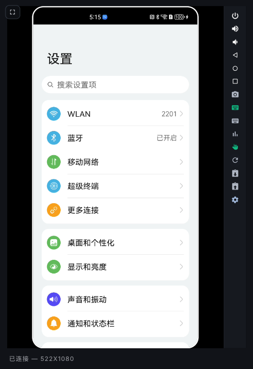
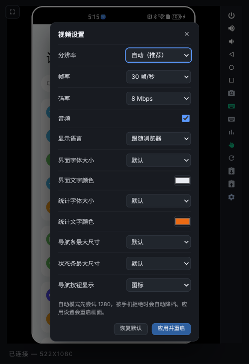
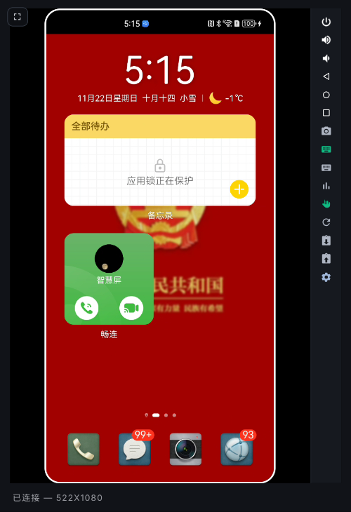

# Phone Screen Link

把一台华为 Mate 40 Pro 的**整台屏幕**投到本机浏览器，并在网页上反向控制手机。
视频流和触摸走成熟的开源引擎 [ws-scrcpy-web](https://github.com/bilbospocketses/ws-scrcpy-web)
v0.5.13，Home / Back / 音量 / 电源等按键走一条轻量 ADB 控制桥。

> **范围**：仅本机 `http://127.0.0.1:8000`；不 root、不在手机安装额外 App、不绕过锁屏、
> 不采集 `FLAG_SECURE` / DRM 内容。远程访问未在本次实现，但架构预留了扩展空间。

## 开源组件声明

本项目的投屏引擎来自开源项目，在此明确声明：

| 组件 | 版本 | 来源 | 许可证 | 在本项目中的作用 |
| --- | --- | --- | --- | --- |
| [ws-scrcpy-web](https://github.com/bilbospocketses/ws-scrcpy-web) | v0.5.13 | https://github.com/bilbospocketses/ws-scrcpy-web | **GPL-3.0** | HTTP/WebSocket 服务、WebCodecs 解码、投屏画面、触摸/滚轮/剪贴板控制与工具箱 |

- 引擎代码**不包含在本仓库中**：`npm run setup` 从上述上游仓库克隆到 `engine/`，它独立遵循上游的 GPL-3.0 许可证；本仓库只提交我们自己的封装代码。
- 本项目的改动限于：把 HTTP 服务限制为只监听 `127.0.0.1`（修改 `src/server/services/HttpServer.ts` 的 `server.listen`），以及用自定义的 `index.html` / `app.js` / `styles.css` 替换引擎根页面。投屏协议实现本身没有改动。
- 引擎运行时还依赖上游的 scrcpy-server 等组件，它们的版权与许可证同样属于各自上游项目。
- 致谢：整屏投射与触摸反控能力来自 ws-scrcpy-web 及 scrcpy 社区，本项目只做本机启动编排、控制桥和界面封装。

## 界面预览

**主界面** — 手机「设置」页面投屏，顶部是控制按钮，右侧是窄工具栏：



**设置面板** — 点击右侧齿轮打开，可调整分辨率、帧率、码率和音频：



**手机主屏幕投屏** — 整台手机屏幕实时镜像：



## 功能

- **全屏镜像**：整台手机画面实时投到浏览器，不是单个 App 的截图。
- **网页反控**：右侧窄工具栏里的 `电源 / 音量+ / 音量− / 返回 / 主页 / 多任务` 六个系统按键；顶部导航栏已隐藏，所有操作集中在右侧。
- **自然交互**：鼠标左键点击和拖拽等价于手指触摸；滚轮上下滚动手机页面；右键映射为手机返回键，浏览器右键菜单已被禁用。
- **屏幕外观**：画面为圆角矩形，带白色描边和上下各 2px 间隔；外侧容器不加边框、圆角或阴影。
- **画面全屏**：画面左上角的图标按钮（悬浮提示「全屏 / 退出全屏」）可让手机画面铺满视口（隐藏工具栏），画面圆角、白色描边和间隔保持不变，按 `Esc` 也可退出。
- **设置面板**：右侧工具栏的齿轮按钮可设置分辨率、帧率、码率、音频、语言、字体与导航条/状态条尺寸，改动立即生效并自动重启画面流。
- **状态联动**：每 3 秒轮询手机锁屏/休眠状态并显示在状态栏，锁屏黑屏时给出明确提示。
- **多语言界面**：中文 / 英文，在设置面板切换，默认跟随浏览器语言，即时生效无需刷新；按钮文字、状态提示、锁屏/剪贴板提示、右侧工具栏的悬浮提示（tooltip），以及引擎直接绘制在画面上的画质统计文字都会一起翻译。
- **分辨率自适应**：自动探测设备编码器能接受的尺寸，画面糊时自动降档，无需手动调参。

## 界面与操作

| 操作 | 方式 | 实现 |
| --- | --- | --- |
| 系统按键 | 右侧工具栏 `电源 / 音量+ / 音量− / 返回 / 主页 / 多任务` | 引擎控制通道 |
| 点击 / 拖拽 / 滑动 | 画面上的鼠标左键 | 引擎触摸层 |
| 屏幕滚动 | 画面上的滚轮 | 引擎 `ScrollControlMessage`（触摸模式下的手指滑动） |
| 返回 | 画面上鼠标右键 | 引擎映射 BACK，浏览器菜单已屏蔽 |
| 截图 / 键盘 / 鼠标 / 统计 / 显示模式 / 刷新 / 剪贴板 | 右侧窄工具栏 | 引擎自带工具，带文字标签 |
| 设置 | 工具栏 `SET` 齿轮 | 自定义面板，见下节 |
| 画面全屏 / 退出 | 画面左上角图标按钮（tooltip），或 `Esc` 退出 | CSS 铺满视口，全屏时隐藏工具栏，保留画面圆角与描边 |

右侧工具栏把引擎自带的图标按钮压缩成窄栏并补上文字标签；顶部导航栏已隐藏，系统按键和工具都在同一条栏里，避免重复入口。

### 设置项

| 选项 | 可选项 | 说明 |
| --- | --- | --- |
| 分辨率 | 自动 / 1280 / 1080 / 720 | 「自动」按 `1280 → 1080 → 720` 依次尝试；固定值严格按所选值请求 |
| 帧率 | 15 / 30 / 60 fps | 引擎作为上限使用 |
| 码率 | 2 / 4 / 8 / 16 Mbps | 越高越清晰，占用带宽越大 |
| 音频 | 开 / 关 | 关闭后不再传输手机音频 |
| 显示语言 | 跟随浏览器 / 中文 / English | 「跟随浏览器」在 `zh` 前缀时用中文，否则用英文；切换后立即生效 |
| 界面字体大小 / 颜色 | 小 / 默认 / 大；任意十六进制颜色 | 同时影响按钮、状态栏、工具栏标签和设置面板 |
| 统计字体大小 / 颜色 | 小 / 默认 / 大；任意十六进制颜色 | 只影响投屏画面上 canvas 绘制的画质统计文字 |
| 导航条最大尺寸 | 0.8× / 1× / 1.25× | 按倍数固定右侧工具栏的宽度、图标和文字；不受「界面字体大小」影响 |
| 状态条最大尺寸 | 0.8× / 1× / 1.25× | 按倍数固定底部状态栏的高度和文字；不受「界面字体大小」影响 |
| 导航按钮显示 | 图标 / 文字 / 图标&文字 | 控制右侧工具栏按钮只显示图标、只显示文字，或两者都显示 |

设置保存在浏览器 `localStorage`，刷新页面后仍然有效；`Reset` 填回默认值，`Esc`、点遮罩或点 `×` 关闭面板。

**为什么要做分辨率阶梯**：实测 Mate 40 Pro 屏幕为 1152×2376，但引擎按视口反推请求尺寸时，设备编码器会拒绝请求并抛出
`IllegalArgumentException`，回退到最大边 512 的帧（248×512），被浏览器放大后明显发糊。该编码器能接受的上限还会随设备状态变化，
因此页面在连上后检查协商分辨率，一旦被大幅降级就自动重启并降低一档；实测稳定结果为 **522×1080**（约 4.4 倍像素量）。

## 架构

```
浏览器 (http://127.0.0.1:8000)
├── web/               自定义页面：设置面板、状态栏、对引擎工具栏的包装
│   └── shared/keys.mjs  浏览器与 Node 共用的按键码、设置校验、分辨率策略
├── engine/             ws-scrcpy-web v0.5.13（由 npm run setup 拉取，不入库）
│   ├── HTTP :8000     仅绑定 127.0.0.1，提供页面与 WebSocket
│   └── scrcpy-server  视频/音频流 + 触摸/滚轮/剪贴板控制通道
└── control bridge     http://127.0.0.1:8100
    └── POST /keyevent → adb input keyevent → 手机
```

三个部分各司其职：**引擎**负责视频解码和控制协议，**桥**只做按键转发，
**页面**负责交互层和分辨率/设置策略。`scripts/start.mjs` 负责资源复制、进程启动、就绪等待和信号清理。

安全边界：引擎与桥都只绑定回环地址；桥的 CORS 白名单仅允许
`http://127.0.0.1:8000` 与 `http://localhost:8000` 两个精确来源；启动时强制断开 Wi‑Fi ADB，只允许固定 USB 设备。

## 快速开始

### 环境

- Node.js（开发验证于 v26）与 npm
- 可用的 `adb`（引擎会自带一份）
- 通过 USB 连接、已授权 USB 调试的华为 Mate 40 Pro

### 安装与运行

```sh
npm run setup   # 首次运行：克隆并构建固定版本引擎，打上仅监听 127.0.0.1 的补丁（已构建则跳过）
npm start       # 复制 web/ 资源、启动引擎和控制桥
npm test        # 运行 44 个单元测试
```

浏览器打开 <http://127.0.0.1:8000/>。按 `Ctrl-C` 或发送 `SIGTERM` 即可干净停止引擎和桥，无需进程守护工具。

> 修改 `web/` 或 `shared/` 后必须**重启 `npm start`**：自定义页面只在启动时复制到引擎目录。
> 修改 `server/` 后同样需要重启桥。

## 引擎安装（ws-scrcpy-web）

### 自动安装（推荐）

```sh
npm run setup
```

`scripts/setup.mjs` 会依次执行以下步骤，全部在项目根目录完成：

1. 用 `git clone --depth 1 --branch v0.5.13` 把上游仓库克隆到 `engine/`；
2. 在 `engine/` 中运行 `npm install` 安装依赖；
3. 打上 loopback 补丁：把 `src/server/services/HttpServer.ts` 中的 `server.listen(port, () => {`
   改为 `server.listen(port, '127.0.0.1', () => {`，保证 HTTP 只监听本机；若上游代码结构变化导致匹配不到，脚本会直接报错而不是静默跳过；
4. 运行 `npm run stage-seed`，把运行期需要的 `adb`、`scrcpy-server`、node-pty 等依赖落到 `engine/dependencies/`；
5. 运行 `npm run build` 生成 `engine/dist/index.js`。

该命令是**幂等**的：检测到 `engine/dist/index.js` 已存在就跳过，不会重复克隆或覆盖已有构建。

### 手动安装 / 调试引擎

需要自定义引擎版本或排查安装问题时，可按上面的顺序手工执行：

```sh
git clone --depth 1 --branch v0.5.13 \
  https://github.com/bilbospocketses/ws-scrcpy-web.git engine
cd engine
npm install
# 编辑 src/server/services/HttpServer.ts：server.listen(port, '127.0.0.1', () => {
npm run stage-seed
npm run build
```

注意：

- 若跳过 loopback 补丁，引擎会监听所有网卡，不符合本项目的本机安全边界；`scripts/start.mjs` 仍按 `127.0.0.1:8000` 访问。
- 升级引擎版本时修改 `scripts/setup.mjs` 中的 `ENGINE_TAG`，删除 `engine/` 后重新运行 `npm run setup`，再重启 `npm start`。
- 引擎启动时会尝试下载**可选**的 node-pty 预编译包。在需要代理的网络环境中，Node 的 `fetch` 默认不读取 `HTTP(S)_PROXY`，`scripts/start.mjs` 检测到代理变量后会自动传入 `NODE_USE_ENV_PROXY=1` 和 `--use-system-ca`，避免因此卡住启动。

### 自定义页面如何进入引擎

`npm start` 会把：

- `web/index.html`、`web/app.js`、`web/styles.css` 原样复制到 `engine/dist/public/`；
- `shared/keys.mjs` 复制为 `engine/dist/public/keys.js`（引擎静态服务器不支持 `.mjs` 的 MIME 类型且设置了 `nosniff`，所以浏览器侧必须用 `.js` 扩展名）。

因此每次修改 `web/` 或 `shared/` 都要重新运行 `npm start` 才能看到效果。

## 配置

- **设备序列号**：固定为 `2FD0221C09004177`，定义在 `server/adb.mjs`（`DEFAULT_USB_SERIAL`）和 `web/app.js`（`DEVICE_ID`）。换设备需同时改这两处。
- **端口**：引擎 `8000`，控制桥 `8100`，在 `scripts/start.mjs` 中配置。
- **USB 限制**：`scripts/start.mjs` 启动时及每 5 秒断开 Wi‑Fi ADB `192.168.3.123:5555`；无线连接不会被接受。

## 已知限制

- **锁屏黑屏**：Android 的 keyguard 只向 scrcpy 提供黑色画面，这是系统限制，不是流坏了。解锁手机即可，状态栏会显示锁屏提示。
- **安全上下文**：WebCodecs 解码要求 secure context，普通 HTTP 只能在 `127.0.0.1` / `localhost` 上使用；局域网地址（如 `192.168.x.x:8000`）无法解码视频，远程访问需自行加 HTTPS 并放宽 CORS/绑定地址。
- **USB Only**：只允许上述 USB 设备，不实现无线投屏。
- **无守护进程**：刻意不引入 supervisor，由启动脚本自己处理清理。
- **引擎许可**：`engine/` 是 GPLv3 的第三方项目，由 `npm run setup` 单独拉取，未提交到本仓库；详见「开源组件声明」与「引擎安装」。

## 故障排查

| 现象 | 处理 |
| --- | --- |
| 状态栏显示 `Engine unavailable` | 按「引擎安装」完成 `npm run setup`，再运行 `npm start` |
| 启动报 `engine did not become ready` | 代理环境下 Node 的 `fetch` 不走系统代理，引擎可选依赖下载会超时；启动脚本检测到代理时已自动注入 `NODE_USE_ENV_PROXY=1` 与 `--use-system-ca`，可检查代理/NO_PROXY 设置后重试 |
| 画面糊、状态栏显示 `248x512` | 在设置里选「自动」或 `1080`；日志中会出现编码器 `IllegalArgumentException` |
| 画面全黑但显示已连接 | 手机处于锁屏状态，解锁后恢复；不绕过锁屏 |
| 引擎首次运行弹出安装范围对话框 | 选 “no, me only”；自定义页面通常会替换掉该首页 |
| `npm run setup` 出现 `velopack` 的 `EBADENGINE` 警告 | 可忽略，不影响安装和运行 |

## 目录结构

```
scripts/setup.mjs        克隆/构建/打补丁固定版本引擎
scripts/start.mjs        启动编排：USB 检查、资源复制、进程管理、就绪等待
server/adb.mjs           ADB 可用性检查与设备发现
server/bridge.mjs        回环 HTTP 控制桥（/health、/keyevent，含 CORS 白名单）
shared/keys.mjs          共用按键码、设置校验与分辨率策略
web/index.html           页面结构与设置面板
web/app.js               状态栏、按钮处理、设置持久化、工具栏包装
web/styles.css           紧凑暗色主题与布局覆盖
tests/*.test.mjs         39 个 node:test 用例
docs/screenshots/        README 中使用的界面截图
docs/superpowers/        设计规格、实施计划与开发台账
engine/                  GPLv3 第三方引擎，由 setup 生成，已加入 .gitignore
```

## 测试

```sh
npm test
```

覆盖 ADB 设备筛选、桥的 CORS/按键接口、引擎安装与启动编排、按键码、设置校验与持久化、
分辨率阶梯与降级检测等，共 44 个用例。
